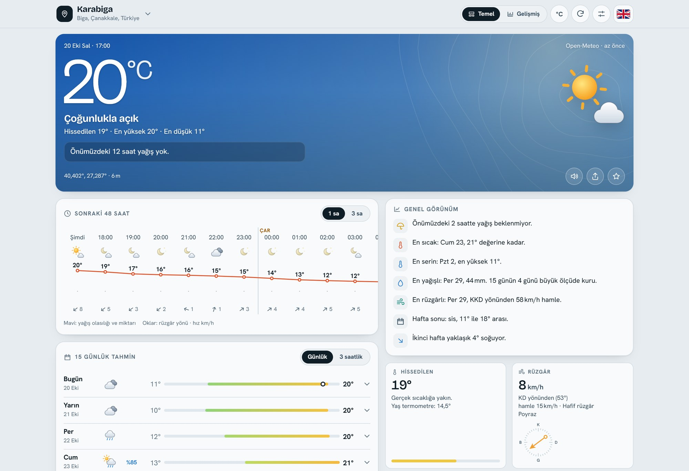
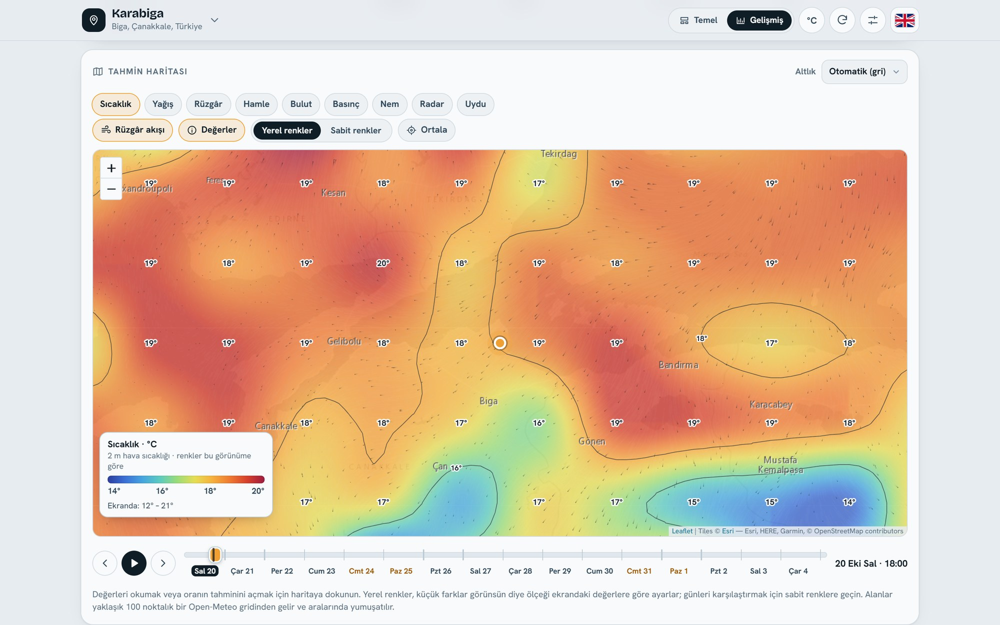

# Isobar Weather

Ücretsiz 15 günlük hava tahmini: saatlik ya da 3 saatlik ayrıntı, hava haritası, model karşılaştırması ve tahmin güveni. Tek bir HTML dosyası; API anahtarı, hesap ya da sunucu gerekmez.
A free 15-day weather forecast with hourly or 3-hourly detail, a weather map, model comparison and forecast confidence. One HTML file: no API key, no account, no server.

**Canlı sürüm / Live:** https://erenciracioglu-dotcom.github.io/isobar-weather/

| Temel mod · Basic mode | Gelişmiş mod · Advanced mode |
|---|---|
|  |  |

[Türkçe](#türkçe) · [English](#english)

## Türkçe

Isobar iki uygulamayı bir arada sunar: her gün bakılan sade bir hava uygulaması ve hava durumunu ayrıntısıyla izlemek isteyenler için bir panel. Açılışta konumunuzu sorar; izin vermezseniz Karabiga'yı (Biga, Çanakkale) gösterir. Arayüz Türkçe açılır; sağ üstteki bayrakla İngilizceye geçer.

### Temel mod

- Anlık durum, hissedilen sıcaklık, günün kısa özeti ve uyarılar (kuvvetli rüzgâr, sıcak, don, fırtına)
- Yağmur yaklaşıyorsa önümüzdeki 2 saat için 15 dakikalık yağış tahmini
- 48 saatlik saatlik akış
- 15 gün: günlük liste ya da 3 saatlik ızgara. Izgaradaki her kutuda yağış ve rüzgâr var; kutuların renklerini ızgaranın hemen üstünden sıcaklığa, yağışa ya da rüzgâra göre seçebilirsiniz.
- 15 günlük sıcaklık ve yağış eğrisi; en sıcak, en yağışlı ve en rüzgârlı günleri söyleyen bir özet
- Etkinlik planlayıcı: koşu, bisiklet, yürüyüş, plaj, mangal, çamaşır kurutma, yıldız gözlemi ve drone uçuşu için en uygun saatler
- Yer arama, favoriler ve paylaşılabilir bağlantı. Son tahminler cihazda saklanır; bağlantı koparsa son veri gösterilir.

### Gelişmiş mod

- Ayrıntılı anlık durum, altı grupta: sıcaklık ve nem, rüzgâr, basınç ve gökyüzü, yağış ve güneş, atmosfer (CAPE, donma seviyesi), toprak
- Hava haritası: sıcaklık, yağış, rüzgâr, hamle, bulut, basınç (izobarlarla), nem, radar ve uydu katmanları; rüzgâr akışı animasyonu; tarihli zaman çubuğu; haritada dokunulan noktanın tahmini. Altlıklar gri, koyu, sokak, topografik, arazi ve uydu; hiçbiri anahtar istemez.
- Meteogram: 48 saat, 7 gün ya da 15 gün; sıcaklık, yağış, rüzgâr ve 10 panel daha
- Güneş ve ay; deniz (dalga, ölü dalga, deniz suyu sıcaklığı)
- Model karşılaştırması: 8 küresel model, sıcaklık, rüzgâr, hamle ya da yağış için
- Hava kalitesi ve polen
- Tahmin güveni: aynı modelin onlarca çalıştırmasının yayılımı ve günlük yağış olasılığı
- 1991–2020 normalleriyle karşılaştırma
- Saatlik veri tablosu ve CSV dışa aktarma

Birimler tek dokunuşla değişir: °C/°F; km/h, m/s, mph, knot, Beaufort; mm/inç; hPa, mmHg, inHg; km/mil; 24/12 saat.

### Kullanım

- **Windows:** canlı adresi açın ya da `index.html` dosyasını indirip çift tıklayın (Chrome ya da Edge).
- **Android ve iPhone:** canlı adresi açın, tarayıcı menüsünden "Ana ekrana ekle"yi seçin. iPhone yerel HTML dosyalarını çalıştırmadığı için telefonda canlı adres kullanılmalı.
- İnternet bağlantısı gerekir. Bütün kaynaklar ücretsizdir; biri yanıt vermezse uygulama sıradakine geçer.

### Veri kaynakları

| Veri | Kaynak (yedekler sırasıyla) |
|---|---|
| Tahmin | Open-Meteo → MET Norway → wttr.in → 7Timer!; eksik günler ve değişkenler NOAA GFS'ten |
| Hava kalitesi, polen | Open-Meteo (CAMS) |
| Deniz | Open-Meteo Marine |
| Tahmin güveni | Open-Meteo Ensemble: ECMWF IFS → GFS → ICON |
| İklim normalleri | Open-Meteo Archive (ERA5, 1991–2020) |
| Harita | Leaflet; altlık Esri ve OpenTopoMap; radar RainViewer; uydu NASA GIBS |
| Yer arama | Open-Meteo → Photon → Nominatim; yer adı BigDataCloud → Nominatim |

### Geliştirme

`index.html` derlenmiş dosyadır; kaynak `src/` klasöründe. `python build.py` parçaları birleştirip `index.html`'i yeniden yazar, Node ile sözdizimini ve çeviri anahtarlarını denetler. Testler bütün servisleri taklit eder, ağ gerektirmez: `pip install playwright`, `python -m playwright install chromium`, ardından `python test/run2.py` (ilk turun testleri `test/run.py`).

### Hakkında

Isobar Weather, Eren'in istekleri ve geri bildirimleriyle Claude (Anthropic) tarafından yapıldı; Ekim 2026.

## English

Isobar is two apps in one: a plain everyday weather app, and a panel for people who like to follow the weather in detail. On first start it asks for your location; if you say no, it shows Karabiga (Biga, Çanakkale, Türkiye). The interface opens in Turkish; the flag at the top right switches it to English.

### Basic mode

- Current weather, feels-like temperature, a short summary of the day and alerts (strong wind, heat, frost, storms)
- When rain is coming, a 15-minute precipitation forecast for the next 2 hours
- A 48-hour hourly strip
- 15 days as a daily list or a 3-hourly grid. Every cell of the grid shows rain and wind; a switch just above the grid colours the cells by temperature, rain or wind.
- A 15-day temperature and rain chart, and an outlook that names the warmest, wettest and windiest days
- Activity planner: the best hours for running, cycling, hiking, the beach, a barbecue, drying laundry, stargazing and drone flying
- Place search, favourites and shareable links. Recent forecasts are kept on the device; if the connection drops, the last data is shown.

### Advanced mode

- Current conditions in detail, in six groups: temperature and humidity, wind, pressure and sky, rain and sun, atmosphere (CAPE, freezing level), ground
- Weather map: temperature, precipitation, wind, gusts, cloud, pressure (with isobars), humidity, radar and satellite layers; animated wind flow; a time bar with dates; the forecast for any point you tap. Base maps are grey, dark, streets, topographic, terrain and satellite, and none of them needs a key.
- Meteogram over 48 hours, 7 days or 15 days: temperature, precipitation, wind and 10 more panels
- Sun and moon; marine (waves, swell, sea temperature)
- Model comparison: 8 global models, for temperature, wind, gusts or precipitation
- Air quality and pollen
- Forecast confidence: the spread of dozens of runs of the same model, and the daily chance of rain
- Comparison with the 1991–2020 normals
- An hourly data table with CSV export

Units switch with one tap: °C/°F; km/h, m/s, mph, knots, Beaufort; mm/in; hPa, mmHg, inHg; km/mi; 24/12-hour clock.

### Using it

- **Windows:** open the live address, or download `index.html` and double-click it (Chrome or Edge).
- **Android and iPhone:** open the live address and choose "Add to Home Screen" from the browser menu. iPhones don't run local HTML files, so on a phone use the live address.
- It needs an internet connection. Every source is free; if one doesn't answer, the app moves on to the next.

### Data sources

| Data | Source (fallbacks in order) |
|---|---|
| Forecast | Open-Meteo → MET Norway → wttr.in → 7Timer!; missing days and variables from NOAA GFS |
| Air quality, pollen | Open-Meteo (CAMS) |
| Marine | Open-Meteo Marine |
| Forecast confidence | Open-Meteo Ensemble: ECMWF IFS → GFS → ICON |
| Climate normals | Open-Meteo Archive (ERA5, 1991–2020) |
| Map | Leaflet; base maps from Esri and OpenTopoMap; radar from RainViewer; satellite from NASA GIBS |
| Place search | Open-Meteo → Photon → Nominatim; place names from BigDataCloud → Nominatim |

### Development

`index.html` is the built file; the source is in `src/`. `python build.py` joins the parts, rewrites `index.html`, and uses Node to check the syntax and the translation keys. The tests mock every service and need no network: `pip install playwright`, `python -m playwright install chromium`, then `python test/run2.py` (the first round's tests are in `test/run.py`).

### About

Isobar Weather was made by Claude (Anthropic) from Eren's requests and feedback; October 2026.

## Lisans / License

MIT. [LICENSE](LICENSE) dosyasına bakın. See [LICENSE](LICENSE). Leaflet (`vendor/leaflet`) BSD-2-Clause lisanslıdır. Hava verileri kendi kaynaklarının koşullarına tabidir (Open-Meteo: CC BY 4.0).
Leaflet (`vendor/leaflet`) is under the BSD-2-Clause license. Weather data stays under its providers' terms (Open-Meteo: CC BY 4.0).
